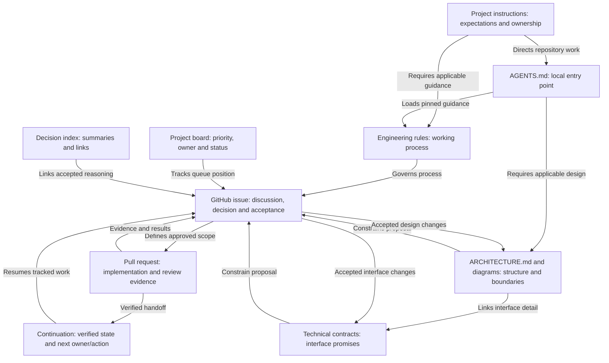
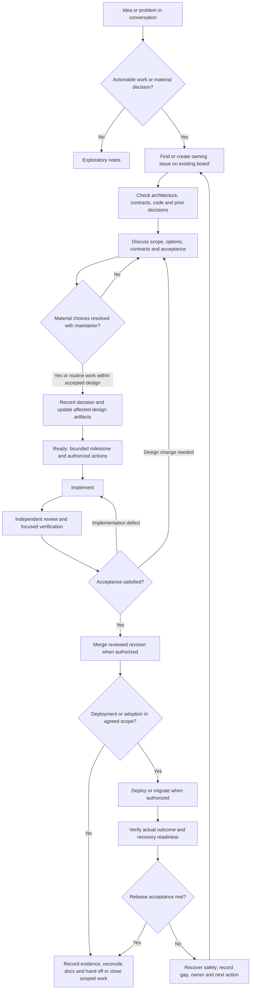

# Development Workflow Constitution

This document governs how development work is formulated and delegated.

Its purpose is speed with control: make agent tasks clear, bounded,
verifiable, and consistent with the project's established architecture.

## Idea to accepted work

This section connects conversation, architectural decisions and tracked delivery.
Apply it proportionally: a routine fix within an accepted design needs a clear
issue and acceptance evidence, not a separate architectural ceremony.

### Keep the workflow proportional

Use one short issue summary and a focused PR for a routine fix within an accepted
design. Briefly state the result, boundary impact and relevant evidence; use
“not applicable” with a reason when needed. Do not require a new ADR, extra meeting,
exhaustive test rounds or every possible artifact for a small change. Existing
accepted decisions and valid unchanged evidence are reused. A material change to
responsibility, authoritative state, interfaces, compatibility or operational risk
uses the fuller design path below. If classification is uncertain, explain the
concrete impact rather than expanding the process by default.

### Information ownership

| Location | Owns |
| --- | --- |
| Project instructions | Standing project expectations and links to authoritative guidance |
| Shared engineering rules | Cross-project planning, implementation, review and delivery process |
| Repository `AGENTS.md` | Local entry point, repository facts and required reading |
| `ARCHITECTURE.md` and diagrams | Accepted structure, boundaries and state owners; clearly labelled proposals |
| Technical contracts | Interfaces, compatibility, failure behavior and consumer obligations |
| GitHub issue | Problem, material discussion, decision, authorization references and acceptance evidence |
| GitHub project board | Priority, owner and workflow position of that same issue |
| `docs/DECISIONS.md` | Concise decision index linking to authoritative issue records |
| Continuation record | Verified stopping point, preservation status, blockers and next owner/action |

Keep one maintained copy. Project instructions and `AGENTS.md` link to shared
rules rather than duplicating them. BardBox owns platform contracts; each
application repository owns its implementation and application architecture.
A journal or chat is exploratory input, not a replacement for the issue record.

### From conversation to implementation

1. **Capture useful work.** Ideas can remain exploratory. When an idea becomes
   actionable work or a material design decision, first find an existing owning
   issue and project board. Reuse them; create an issue if needed. A project
   card references that issue rather than becoming a second discussion record.
2. **Establish the baseline.** Read the current checkpoint, applicable rules,
   architecture, contracts, implementation, prior decisions and evidence. State
   what exists, what is proposed and what remains unknown.
3. **Discuss a bounded proposal.** Present the intended result, exclusions,
   affected owners/interfaces, credible alternatives, consequences and observable
   acceptance criteria. Include the module contract overview required by
   `agent-practice.md` directly in the conversation. Resolve material open
   choices with the maintainer before dependent implementation. For material work,
   name the affected architecture/contract sections, component and state owners,
   preserved invariants and normal/failure paths. Explain how the proposed change
   respects each affected boundary or identify the departure needing a decision.
   “Architecture checked” without this explanation is not evidence.
4. **Preserve the accepted decision.** Record the material discussion and accepted
   conclusion in the owning issue before delegation. Link the maintainer's
   authorization or accurately summarize its scope; do not invent approval.
   Update affected architecture, contracts and Mermaid diagrams with clear
   proposal/current labels. Unmerged changes remain proposals.
5. **Make the issue ready.** Scope, acceptance, dependencies, implementation owner,
   review owner and authorized actions must be clear. Delegate one bounded
   milestone using the issue and governing revisions. Do not make agents depend
   on reconstructing chat history.
6. **Implement, review and deliver.** Follow the delivery sequence below. Fix
   implementation defects on the same branch; reopen the design discussion if
   the accepted design must change. Reconcile affected documentation and diagrams
   with the actual implementation before claiming completion. In the PR, map each
   acceptance criterion to its satisfying change and evidence at the reviewed
   revision. Evidence may be a focused automated test, inspection, rendered page,
   simulated dependency, hardware observation or deployment check; label its level
   and limits. This mapping does not require extra tests for unchanged behavior.
   The reviewer checks both acceptance and architectural claims against the diff.

A significant architectural decision uses a lightweight record in the issue:
**Context; Decision; Alternatives and rejection reasons; Consequences; Acceptance.**
Record its status (proposed, accepted or superseded) and acceptance reference.
Give accepted decisions a stable identifier and a dated, direct issue-comment
anchor stating the exact choice, rationale, approver/authorization reference and
scope. A comment is still editable: treat accepted decision entries as append-only
by convention, not as a technical immutability guarantee. Correct or supersede one
through a new linked entry; do not silently change what an old approval means.
Issue summaries can be refreshed but must link the specific decision entry and
separate design status from implementation/adoption status. Record assumptions and
conditions for reconsideration when they materially affect the choice. If the
reasoning or approval cannot be verified, mark the gap rather than reconstructing
approval. Link a genuinely new proposal until its own review and acceptance.
Keep a repository `docs/DECISIONS.md` index for significant decisions, linked from
its architecture or README: a stable decision identifier, short summary, status
and issue link are enough. Do not copy the full record into that index. Preserve
superseded reasoning and link to its replacement. Shared decisions belong in
BardBox or engineering-standards according to ownership; application indexes
link to them rather than maintaining duplicate decisions. Introduce this
convention with relevant new work; do not fabricate a historical backfill.

### Status, authorization and closeout

Use the existing board's workflow; the common sequence is Backlog, Ready,
In progress, Review and Done, with Blocked for a concrete dependency or decision.
The board owns queue position; the issue owns scope and evidence.

Keep delivery facts explicit and separate from queue status: implemented,
tested, reviewed, merged, deployed and physically verified are different claims.
Record the exact revision, evidence and remaining work. If the agreed goal is a
live service, completion of a code issue alone does not complete that goal;
track the remaining release work with an owner and next step.

Design acceptance, implementation authorization, merge authorization and
operational authorization are distinct. The maintainer may authorize several
steps in advance. Reuse that authorization within its scope instead of asking
again; review success alone grants no additional authorization.

At handoff or completion, update the authoritative issue and continuation
record with branch/commit, issue/PR links, evidence, delivery stage, preservation
status, blockers and exact next owner/action. Check affected instruction entry
points, templates and coordination skills for drift; record necessary follow-up
without copying this workflow into each consumer.

### Handover and lightweight scaffolding

For a new or materially changed module, provide or update a concise guide in the
owning repository: purpose and boundaries, public contract, reasons/decision links,
a minimal use example, run/test instructions, expected failure behavior and known
limits. Shared BardBox design/contracts stay in BardBox; the reference template
links them and owns only implementation-specific usage and evidence.

A fresh maintainer or reviewer should be able to follow requirement → dated
accepted decision → architecture/contract → implementation PR → verification →
release/adoption evidence without the original conversation. Use this cold-handover
check at meaningful module/release milestones, not on every minor fix. Report
missing links honestly; a fresh reader need not operate live systems to check them.

Name the continuing maintainer role and backup owner where applicable. Before
operational handover, verify authorized successors can access repositories, release
artifacts and recovery/runbook locations. Record evidence and remaining gaps in
protected operational records; never publish credentials or private access details.
An access checklist grants no access and authorizes no credential or permission
changes. An unassigned owner is an explicit gap, not an assumed succession plan.

Use short GitHub issue and PR templates as prompts for this process. Engineering
standards maintains reusable forms; the project template ships the same supported
forms for newly created repositories, with provenance links. These operational
copies are not independent sources of policy: changes to shared prompts update the
maintained source and known packaged copy in the same change or name the drift.
Existing repositories adopt them deliberately. A shape/link/diagram check can
catch omissions, not prove architectural correctness or truthful approval.

## 1. Prompt Preflight

Before giving a coding task to an agent, check the request.

### Intent
- What exactly are we trying to accomplish?
- Is the requested behavior clear?
- Are important assumptions still unresolved?

If the intent is unclear, clarify it before implementation.

### Boundaries
- Is this one reasonably scoped task?
- What should change?
- What must NOT change?
- Is the likely blast radius small enough to review and recover from?

If the task is too broad, decompose it.

### Verification
Define "done" before implementation.

Ask:
- What observable behavior proves success?
- What test, command, measurement, or inspection will verify it?
- What normal case should work?
- What important edge case should work?
- What failure/error case should behave safely?

If we cannot cheaply determine whether the task succeeded,
the task is not ready to delegate.

## 2. Project Compliance

Before implementation, read:

1. `AGENTS.md`
2. `ARCHITECTURE.md`
3. Any relevant documents referenced by them

For BardBox and Bard Physics Lab web applications, hosting, email, messaging,
SMS, authentication or monitoring, also read
[Bard applicability and service guidance](docs/bard-it/README.md) and the
[original institutional requirements](docs/bard-it/web-application-and-hosting-requirements.pdf).
Apply the policy to current and future projects wherever applicable; preserve
its conditional language and keep meeting suggestions distinct from mandates.
Assess existing-project gaps in the owning GitHub tracker. Resolve uncertain
applicability with Bard IT/PR rather than assuming compliance or exemptions.

Check the proposed task against those documents.

Specifically ask:
- Does this preserve existing architectural decisions?
- Does it cross an established interface or ownership boundary?
- Does it duplicate something that already exists?
- Does it violate a project rule or convention?
- Does completing it require an architectural decision that has not
  yet been made?

If there is a conflict or ambiguity, stop and resolve it before coding.

## 3. Execution

Work from a known-good state: the current `main` (section 6).

For each task:

Define done → Design → Decompose → Implement → Verify → Commit →
Review → Integrate

Each implementation step should be small enough to:
- understand,
- verify,
- review,
- and revert cheaply.

Do not build new work on top of an unverified change.

## 4. Human Checkpoint

Before implementation begins, present the proposed task back to the maintainer
in plain language:

**Goal:** What are we changing?

**Boundaries:** What are we deliberately not changing?

**Verification:** How will we know it worked?

**Project compliance:** Does it comply with `AGENTS.md`,
`ARCHITECTURE.md`, and relevant project documentation?

**Open questions:** What, if anything, must be decided first?

Do not begin implementation until unresolved questions that materially
affect the design or verification have been resolved.

Presenting the checkpoint is not a request for new authorization. If the
maintainer has already authorized the task and no question that materially
affects the design or verification is open, present the checkpoint and
proceed. Do not ask again for authorization already given. Authorization
covers only the actions it names.

## 5. Recovery Rule

If either the maintainer or the agent can no longer clearly explain:

- what is being changed,
- why it is being changed,
- what state the implementation is in,
- or how it will be verified,

stop adding functionality.

Summarize → Verify → Return to a known-good state → Re-scope →
Continue with the smallest verifiable step.

## 6. Delivery Sequence

Work is delivered one feature at a time, in the repository's one canonical
checkout (`checkouts-and-worktrees.md`, rules 1 to 4).

- **`main` is the baseline.** It holds the last tested and independently
  reviewed working version. Any maintainer-authorized review exception is named
  against the exact revision under `agent-coordination.md`; it is never implied
  by permission to implement or merge. Nobody pushes unreviewed work to `main`
  outside such an explicit exception.
- **One active feature branch.** Start it from the current `main`. The
  implementing agent implements and tests on it, then hands off a clean,
  known commit with its evidence. The reviewing agent reviews that exact
  head. Findings are fixed on the same branch and the new head is reviewed.
- **Integrate before the next feature.** Reviewed, passing work is merged
  into `main` and pushed before the next feature branch starts. Do not
  accumulate completed but unmerged branches.
- **Distinct steps.** Implementation, review, merge and deployment are
  separate steps with separate approvals. A passing review does not by
  itself authorize a merge; passing tests do not show deployment.
- **Exceptions are named.** If a task genuinely cannot follow this sequence,
  name the concrete conflict to the maintainer instead of bypassing it.

### Reusing hardware evidence

Completed hardware acceptance evidence stays valid for behavior that has not
changed. Repeat a hardware acceptance check only for a concrete changed
behavior: name the changed invariant and why the existing evidence cannot
cover it. Record which existing evidence was reused and at which commit.

## Core Principle

Important state lives in files, not conversation history.

Work proceeds only from verified checkpoints.

Humans control scope and architectural decisions; mechanical
guardrails should enforce critical objective rules where practical.
